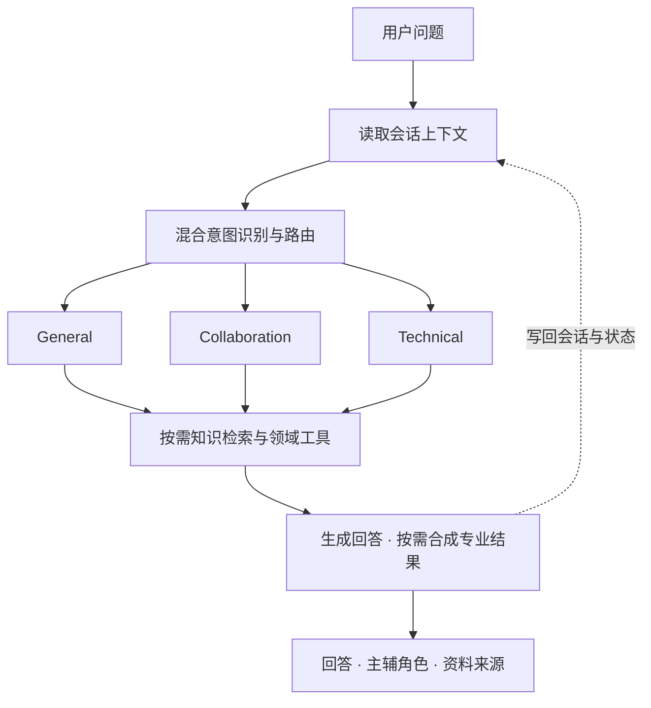

# Ordo

> 面向团队协作的 Multi-Agent 智能支持中心


Ordo 将项目使用、成员权限和平台技术问题整合到一段对话中。系统结合用户意图与会话上下文选择处理角色，为跨领域请求组织主辅协作，再通过产品知识检索和领域工具给出针对性的解答。

从“怎么创建私有项目”到“有编辑权限却无法保存”，用户可以沿着同一段对话继续追问。界面同步呈现支持角色、工具执行情况与资料来源，让处理过程和答案依据都能被查看。

Ordo还内置了意图识别与问答质量评测，可通过可视化报告和同范围基线对比，检查模型、提示词或知识配置调整后的效果，将问题处理与质量验证放在同一应用中。

## 核心设计

| 设计 | 实现方式 |
| --- | --- |
| **混合意图路由** | 融合模型语义、向量相似度与规则匹配，覆盖14类意图，将请求交给对应领域的 Agent |
| **主辅 Agent 协作** | 单领域问题由对应角色处理；跨领域问题按需组织主辅角色并行分析，再合成一条回复 |
| **带来源的增强检索** | Markdown结构切块、本地向量嵌入、多角度查询改写与结果重排，回答可查看实际检索来源 |
| **连续的对话上下文** | 结合工作记忆、结构化会话状态、压缩摘要和用户偏好，保留追问中的对象与条件；按用户和会话隔离数据 |
| **可恢复的请求处理** | 会话锁、原子请求回执和幂等重放减少重复处理，工具调用具备超时、缓存与熔断机制 |
| **可观察的运行过程** | 记录工具轨迹与资料证据，通过Prometheus和页面状态展示耗时、成功率及告警，并将表现反馈到角色路由 |
| **可评测的回答质量** | 支持意图指标、模型多维评分、逐项结果与同范围回归对比；评测使用独立编排状态和工具缓存 |

## 三种角色，一条支持流程

| Agent | 处理领域 | 典型问题 |
| --- | --- | --- |
| **General** | 平台介绍、诉求澄清与对话衔接 | “这个平台能帮团队做什么？” |
| **Collaboration** | 项目创建、成员邀请、文档协作、分享和权限规则 | “guest为什么不能编辑这份文档？” |
| **Technical** | 页面加载、文件传输、保存同步、站内提醒与固定API排查 | “有编辑权限，为什么一直保存失败？” |

对于组合问题，例如：

> 我是member，如何创建一个私有项目？另外，调用 `/sandbox/product/v1/me` 需要哪个scope？

系统可以组织Collaboration与Technical共同处理，分别提供项目操作和接口规范方面的依据。普通问题保持单角色响应，是否协作由请求本身决定。需要进一步沟通的事项可整理为结构化摘要。



## 评测与回归

Ordo提供从提交样例到查看报告的评测流程，让角色路由、回答质量和版本变化都有对应的检查入口。

| 评测层次 | 检查内容 |
| --- | --- |
| **意图识别** | 计算Accuracy、Macro-F1及各类别的Precision、Recall和F1，观察问题分类表现 |
| **问答质量** | 使用LLM-as-Judge，从相关性、准确性、完整性、有用性四个维度评分，并支持提供参考答案与核验资料 |
| **执行与协作** | 自定义样例可指定预期角色、意图、必需工具和实体，核对编排执行是否符合要求 |
| **回归对比** | 按题集及评分配置匹配基线，识别指标退化并给出改进建议，避免不同范围的评测直接混比 |

前端提供单轮评测工作区，展示任务进度、有效条目通过率、平均分、逐项结果和退化项；API支持提交自定义单轮或多轮样例。评分失败会单独标记，不计入有效评分；完整且无退化的报告才可更新基线。

## 技术架构

| 层次 | 技术与职责 |
| --- | --- |
| 交互层 | Vue 3、Vite、Nginx，提供对话、知识检索和评测工作区 |
| 服务与编排 | Python 3.12、FastAPI、Anthropic Python SDK，负责角色调度、工具循环与结果合成 |
| 会话存储 | Redis，保存工作记忆、会话状态与请求回执 |
| 向量存储 | ChromaDB，管理产品知识、情景记忆和用户画像 |
| 检索增强 | 本地`all-MiniLM-L6-v2`嵌入，结合查询改写与重排 |
| 工具扩展 | 标准MCP Tools / Resources；外部资料工具默认关闭，可按白名单启用 |
| 运行监控 | Prometheus指标、页面告警与路由恢复反馈 |
| 质量评测 | 意图指标、LLM-as-Judge、执行检查、异步评测任务与基线对比 |

模型服务需提供 Anthropic Messages 兼容接口，并支持工具调用。配置中的 API Key、模型名和服务地址应对应同一供应商。知识嵌入在本地生成，不需要单独的 Embedding API Key。

## 快速启动

准备 Docker Desktop 或 Docker Engine，并安装 Docker Compose v2。首次构建需要下载镜像、依赖及嵌入模型。

1. 复制配置示例：

   ```powershell
   Copy-Item backend/.env.example backend/.env
   ```

   Linux/macOS：`cp backend/.env.example backend/.env`。

2. 编辑 `backend/.env`，设置以下内容：

   ```dotenv
   ANTHROPIC_API_KEY=your-api-key
   ANTHROPIC_BASE_URL=https://your-messages-compatible-endpoint
   ANTHROPIC_MODEL=your-tool-capable-model
   REDIS_PASSWORD=your-local-redis-password
   ```

3. 在仓库根目录启动：

   ```powershell
   powershell -ExecutionPolicy Bypass -File ./compose.ps1 up --detach --build
   ```

   Linux/macOS：`bash ./compose.sh up --detach --build`。

| 入口 | 默认地址 |
| --- | --- |
| Web 界面 | http://localhost:5175 |
| 后端 API 文档 | http://localhost:18000/docs |
| 健康检查 | http://localhost:18000/health |
| Prometheus | http://localhost:19090 |

端口可通过 `ORDO_FRONTEND_PORT`、`ORDO_BACKEND_PORT`、`ORDO_METRICS_PORT` 调整。默认仅绑定本机地址。

首次启动会从 `backend/knowledge/saas/manifest.json` 导入八份产品知识，自动完成切块、嵌入与存储。产品知识、Agent Skill和外部工具配置分开管理，便于调整支持领域。

## 使用

- **对话**：描述目标或粘贴脱敏提示，查看回答、主辅支持角色和资料来源。
- **知识库**：直接检索默认不调用模型；勾选增强检索会使用模型进行改写和重排。
- **评测**：界面会明确提交四条独立样例。启动评测会调用问答模型及评分模型，产生相应费用；API 空请求不会自动运行默认题库。

模型用量随意图识别、工具回合和检索增强而变化，一条消息可能产生多次调用。请使用脱敏信息，不提交密码、完整密钥、Cookie或涉密文档。

Ordo聚焦知识问答、操作指导和问题分析。协作平台的页面与规则由产品资料定义，实际业务办理需在对应平台完成；人工支持请求在本项目中整理为沟通摘要。

## 配置与开发

运行代码位于 `backend/`，界面位于 `frontend/`。知识文档和 Agent Skill 是运行资源，分别位于 `backend/knowledge/saas/` 和 `backend/skills/`。

修改 Python 后重建后端；修改前端后重建前端：

```powershell
powershell -ExecutionPolicy Bypass -File ./compose.ps1 up --detach --build backend frontend
```

本地前端开发需要 Node.js 22：在 `frontend/` 执行 `npm ci`、`npm run dev`，访问 http://localhost:5176。默认代理到本机18000端口，其他后端地址可设置 `VITE_PYTHON_API_URL`。

配置示例列出了模型超时、短任务思考模式、可选意图嵌入和外部 MCP 等设置。`ORDO_API_TOKENS` 可配置接口访问身份，接口角色 `user/admin` 与知识中描述的平台角色不同；`ORDO_ENV=production` 时必须配置有效 Token 映射。

各问答角色还可通过`ORDO_GENERAL_MODEL`、`ORDO_COLLABORATION_MODEL`、`ORDO_TECHNICAL_MODEL`分别指定模型，在同一兼容服务下调整不同任务的模型选择。

停止服务：

```powershell
powershell -ExecutionPolicy Bypass -File ./compose.ps1 down
```

普通停止保留数据卷。只有明确需要重置所有运行数据时才使用 `down --volumes`。
